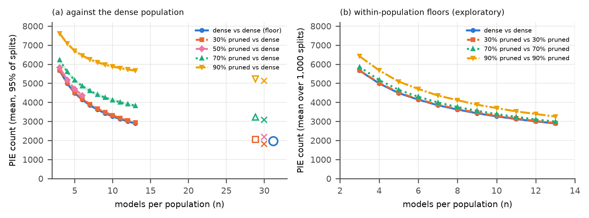

# Seed-noise floors for pruning-identified exemplars in compressed neural networks

Pruning-identified exemplars (PIEs; Hooker et al., arXiv:1911.05248) are images on which the modal prediction of a
population of pruned networks differs from that of a population of dense networks. Two dense populations trained from
different seeds also disagree on some images, and this dense-versus-dense floor had not been reported. This repository
measures it under a pre-registered protocol on the original authors' 123 released ResNet-50 ImageNet checkpoints
(each within 0.1 percentage points of its released accuracy) and compares pruned and quantized populations with the
floor at equal population size, with replications on a second JPEG decoder, ImageNet-V2, ImageNet-ReaL labels and
CIFAR-10 (unstructured and structured pruning). It contains the code, the pre-registration and its four addenda, the
deviation log, the per-image predictions of every model, the analysis outputs with expected checksums, and scripts
that rebuild every number and figure from the stored predictions or rerun the whole study.



*PIE count against the number of models per population (ImageNet validation, 1,000 splits per point). Left: pruned
populations and the dense-versus-dense floor, each against a dense population; right: floors within each population
(exploratory).*

## Key results

ImageNet validation (50,000 images), 13 models per population, 1,000 splits (`results/analysis/ifast/summary.json`;
`z` is the difference from the floor in split standard deviations; values rounded to 3 decimals):

| Comparison | Mean PIE count | Split SD | z vs floor | Pre-registered decision |
|---|---|---|---|---|
| dense 13 v dense 13 (floor, M1) | 2891.254 | 32.398 | | |
| 30% pruned v dense (M2) | 2945.619 | 39.235 | 1.678 | H1 holds (\|z\| ≤ 3) |
| 70% pruned v dense (M2) | 3823.855 | 39.748 | 28.786 | H2 holds (z > 3) |
| 90% pruned v dense (M2) | 5664.182 | 42.548 | 85.590 | H2 holds (z > 3) |
| 50% pruned v dense, 6 v 6 (floor 4140.259) | 4361.309 | 37.331 | 4.900 | |

- The excess over the floor at 30% sparsity is 54.365 images (95% image-bootstrap interval 12.291 to 98.127;
  `image_bootstrap.D_0.3`).
- With the alternative (ISLOW) JPEG decoder the 30% z is 0.796 (`results/analysis/islow/summary.json`), and on
  ImageNet-V2 it is -0.077 (`results/analysis/v2_ifast/summary.json`).
- CIFAR-10 structured filter pruning at 30% sparsity: mean top-1 0.923 against 0.933 for the 60 dense seeds, 225.25
  PIEs against a floor of 173.771, z 5.092 (`results/analysis/cifar/structured.json`).

## Installation

Python 3.13 on Linux (tested with CPython 3.13.13):

```bash
python3.13 -m venv .venv
.venv/bin/pip install -r requirements.lock --extra-index-url https://download.pytorch.org/whl/cu130
```

`requirements.in` lists the top-level pins and `requirements.lock` the full frozen set (PyTorch 2.14.0 with CUDA
13.0, NumPy 2.5.2, SciPy 1.18.1, pandas 3.0.5, simplejpeg 1.9.0). The CPU analysis stage, the tests and the quick
start run with the same environment on a machine without a GPU. `env.txt` records the GPU, driver and cuDNN
version; `logs/gpu_stage_env.txt` lists the full environment in which the GPU prediction stages ran (same top-level
pins).

## Data

No third-party data or model file is redistributed (`NOTICE.md` lists every one with its source, terms and checksum).
The stored per-image predictions in `results/preds*/` are enough for the quick start and most of the analysis stage;
the rest is downloaded by `scripts/reproduce.sh`.

| Input | Source | Terms | Expected path | Checksum | Needed for |
|---|---|---|---|---|---|
| Released class statistics, per-image PIE files and bucket README | `gs://gresearch/pruning_identified_exemplars/` via `python src/bucket.py fetch_meta` (keyless) | non-commercial research use only (bucket README) | `prior-gate/g13/tstat.csv`, `prior-gate/g13/pie07.csv`, `prior-gate/g13/pie09.csv`, `data/bucket_meta/README.md` | `BUCKET_META_SHA256` (checked by the command) | analysis stage |
| ImageNet-ReaL labels | https://raw.githubusercontent.com/google-research/reassessed-imagenet/master/real.json | Apache-2.0 | `data/real/real.json` | sha256 `d83e9bff374c631aae8439eb064c7019acc56e1b3bc3f56b8380c2a710b0220b` | analysis stage |
| 123 ResNet-50 checkpoints (35 GB) | same bucket, `python src/bucket.py fetch all` | non-commercial research use only | `data/ckpt/` | md5 per object from `prior-gate/g13/all.json`; sha256 in `logs/ckpt_all.sha256` | GPU stage |
| ImageNet-1k validation and one training shard | Hugging Face `ILSVRC/imagenet-1k` (gated: accept the terms, set `HF_TOKEN`) | ImageNet terms, non-commercial research and education | `data/imagenet-1k/`, `data/imagenet-1k-train/` | shard sha256 in `logs/train_shard.sha256` | GPU stage, Figure 1 |
| ImageNet-V2 matched-frequency | Hugging Face `vaishaal/ImageNetV2` | MIT | `data/imagenetv2/` | `logs/imagenetv2.sha256` | GPU stage |
| CIFAR-10 | Hugging Face `uoft-cs/cifar10` (parquet) | as published by its authors (dataset card: unknown) | `cifar/cifar10/` | `cifar/cifar10_hf.sha256` | CIFAR-10 training runs |

Inputs for the CPU analysis stage only:

```bash
.venv/bin/python src/bucket.py fetch_meta
mkdir -p data/real && curl -sSfL -o data/real/real.json \
  https://raw.githubusercontent.com/google-research/reassessed-imagenet/master/real.json
echo "d83e9bff374c631aae8439eb064c7019acc56e1b3bc3f56b8380c2a710b0220b  data/real/real.json" | sha256sum -c -
```

## Quick start

One dense-versus-dense split and one 90%-pruned population from the stored predictions (no ImageNet, no GPU,
about 2 s):

```bash
.venv/bin/python scripts/quickstart.py
```

```
dense 13 v dense 13 (floor): 2889 PIEs of 50000 images
pruned 90% 13 v dense 13:    5704 PIEs of 50000 images
over 1,000 splits the paper reports means of 2,891 (floor) and 5,664 (90% sparsity); results/analysis/ifast/summary.json
```

The PIE machinery is importable: `src/analysis.py` provides `modal` (Hooker et al.'s mode with ties to the largest
label), `Pop` (the stored predictions with their roles and sparsities) and `strat_halves` (the stratified split).

## Reproducing the paper

CPU analysis stage, from the stored predictions (35 min measured in a fresh clone on a 16-core machine; needs the two
inputs above):

```bash
scripts/reproduce_analysis.sh
.venv/bin/python tests/check_outputs.py   # expected: 199/199 match
```

This recomputes every table and figure number (A0 fidelity, M1-M4, H1/H2, the ablations, the alternative decoder,
ImageNet-V2, ImageNet-ReaL, CIFAR-10 with ADDENDUM-2 to ADDENDUM-4, the quantization analysis and the exploratory
analyses), writes the supplementary tables to `results/tables/supp_tables.tex`, and `tests/check_outputs.py` compares
the outputs with `EXPECTED_SHA256` (npz files are compared per array payload). The analysis stage is byte-reproducible from the stored predictions.

Whole study, from the raw inputs (idempotent; skips outputs that exist):

```bash
scripts/reproduce.sh
```

It downloads the data and checkpoints, builds the exact float32 network inputs, runs FP32 inference for 123 models
under two JPEG decoders, ImageNet-V2, FP16 and INT8 quantization and the CIFAR-10 training runs, then the analysis
stage, Figure 1 and the tests. On one RTX 5060 Laptop GPU (8 GB) this took about 1 h of downloads, about 9 GPU-h of
FP32 inference, about 5 GPU-h for ImageNet-V2, quantization and CIFAR-10, and about 1 h of CPU analysis, with about
35 GB of checkpoints and 30 GB per float32 input cache. Per-image predictions are bit-identical only on the same GPU,
driver and cuDNN version. GPU sharing is opt-in: `PIE_GPU_LOCK_DIR=<dir>` wraps GPU batches in
`flock <dir>/gpu.gate` and takes `<dir>/gpu.lock` per model.

Figure 1 of the article shows ImageNet validation images, so its files are not included;
`src/fig_examples.py` regenerates it from the gated download, and `results/figures/fig8_examples_selection.json`
names the 12 images. The other article figures are `results/figures/fig1_pie_distributions_ifast` (Figure 2),
`fig2_population_size_ifast` (Figure 3), `fig7_cifar_floor_extrapolation` (Figure 4), `fig4_class_tests_ifast`
(Figure 5) and `fig5_fidelity` (Figure S1).

**Pre-registration.** `preregistration/PREREG.md` and `preregistration/PREREG-ADDENDUM-{1,2,3,4}.md` are frozen;
their SHA-256 sums and freeze times are in `logs/prereg*.sha256`, and `scripts/reproduce.sh` verifies them first.
`INVENTORY.json` (the frozen checkpoint inventory) is verified against `logs/inventory.sha256`.
`preregistration/DEVIATIONS.md` is the append-only, timestamped deviation log (D1-D15 and D11a; D12 and D15 list the
exploratory analyses added in review).

| File | SHA-256 |
|---|---|
| `PREREG.md` | `eba59b5f2cea3cc8f29e47aa2ac5a7ead6541d9173ccc30134d5fdca7f6ac8ae` |
| `PREREG-ADDENDUM-1.md` | `b57266fee4ad6a47d69fa52f71825aaa4adfbe5832eeed1dbb8ed388303c1fb2` |
| `PREREG-ADDENDUM-2.md` | `2267815f3d42e9d873f22c57c21be993e460094b4541f141d51f779298451aa6` |
| `PREREG-ADDENDUM-3.md` | `b194e1cf95e79c285b221a150243cb3917867063131300ee3c6ea90808678d63` |
| `PREREG-ADDENDUM-4.md` | `4bdb3dcda7c1ad84ca859418eb0ec1bddb5f30383ae8989265fd6ca076b162e5` |
| `INVENTORY.json` | `e22d9e71cde6174cf0383a0f9702cc91aaca6a127ccc992bd5d07f2ef34dac45` |

## Repository structure

```
.
├── src/
│   ├── bucket.py            bucket inventory; md5-verified checkpoint and metadata fetch
│   ├── evalpreds.py         original evaluation preprocessing (IFAST decode; --islow); float32 input cache; FP32 predictions
│   ├── fidelity.py          per-model top-1/top-5 against the released statistics (A0)
│   ├── analysis.py          M1-M4, H1/H2, intervals, ablations, full-population recompute
│   ├── m4fix.py             per-class test with degenerate classes excluded (ADDENDUM-3 C1b)
│   ├── a2.py                gate A2: mapping search and label-only Jaccard bound
│   ├── real.py, evalv2.py   ImageNet-ReaL analyses; ImageNet-V2 predictions
│   ├── m5.py                FP16, static INT8 and dynamic-range INT8 (M5/H3)
│   ├── exploratory.py       exploratory analyses (pairwise disagreement, n->30 extrapolation, degenerate classes)
│   ├── explore_r1.py        exploratory analyses added in review (DEVIATIONS D12, D15)
│   ├── diag_preproc.py      decoder diagnosis behind decision D3
│   └── figures.py, fig_examples.py
├── cifar/                   CIFAR-10 populations (airbench94, MIT), analysis, 30 v 30 floor, structured arm
├── prior-gate/g13/          TF1 checkpoint -> PyTorch converter, frozen bucket listing, Hooker et al. code excerpts
├── provenance/              licence texts read first-hand; TensorFlow source excerpts (evidence for D3)
├── tests/                   pipeline checks; expected-output checksums
├── scripts/                 reproduce.sh, reproduce_analysis.sh, make_tables.py, quickstart.py, check_release.py
├── preregistration/         PREREG.md, PREREG-ADDENDUM-{1..4}.md (frozen), DEVIATIONS.md
├── results/                 per-image predictions (preds*, cifar/preds), analysis outputs, diagnostics, figures
├── logs/                    SHA-256 of frozen files and third-party inputs; GPU-stage environment
├── assets/                  README figure
├── INVENTORY.json           frozen checkpoint inventory
├── BUCKET_META_SHA256, EXPECTED_SHA256
└── requirements.in, requirements.lock, env.txt
```

## Tests

| Check | Command | Expected output |
|---|---|---|
| image order, labels, preprocessing, A0 anchors, A1 bit-identity, Hooker tie-break | `.venv/bin/python tests/test_pipeline.py` | 4 lines `PASS test_...` |
| analysis outputs against `EXPECTED_SHA256` (after `scripts/reproduce_analysis.sh`) | `.venv/bin/python tests/check_outputs.py` | `199/199 match` |
| release hygiene (no local paths, e-mail addresses, credentials or files over 90 MB) | `python3 scripts/check_release.py` | `0 hits` |

## Citation

The paper is under review; citation details will be added on publication.

```bibtex
@misc{pie_floor2026,
  title = {Seed-noise floors for pruning-identified exemplars in compressed neural networks},
  year  = {2026}
}
```

## Licence

The code is released under the MIT licence (`LICENSE`). The per-image predictions (`results/preds*/`) and the analysis
outputs derived from them come from the original checkpoints evaluated on ImageNet and inherit their terms: they are
released for non-commercial research use only, with the obligations of the ImageNet access agreement. Third-party files
keep their own terms (`NOTICE.md`): Hooker et al. code excerpts and TensorFlow source excerpts (Apache-2.0), the
airbench94 script (MIT) and the licence texts in `provenance/licences/`.

## Acknowledgements

We use the ResNet-50 checkpoints, class statistics, per-image PIE files and evaluation code released by S. Hooker,
A. Courville, G. Clark, Y. Dauphin and A. Frome ("What do compressed deep neural networks forget?",
arXiv:1911.05248; [google-research/pruning_identified_exemplars](https://github.com/google-research/google-research/tree/master/pruning_identified_exemplars)),
the ImageNet-1k validation set, [ImageNet-V2](https://github.com/modestyachts/ImageNetV2),
[ImageNet-ReaL](https://github.com/google-research/reassessed-imagenet), CIFAR-10, the airbench94 training script of
[cifar10-airbench](https://github.com/KellerJordan/cifar10-airbench), TensorFlow source files for the decoder
analysis, and PyTorch, torchvision, NumPy, SciPy, pandas, simplejpeg and matplotlib.
